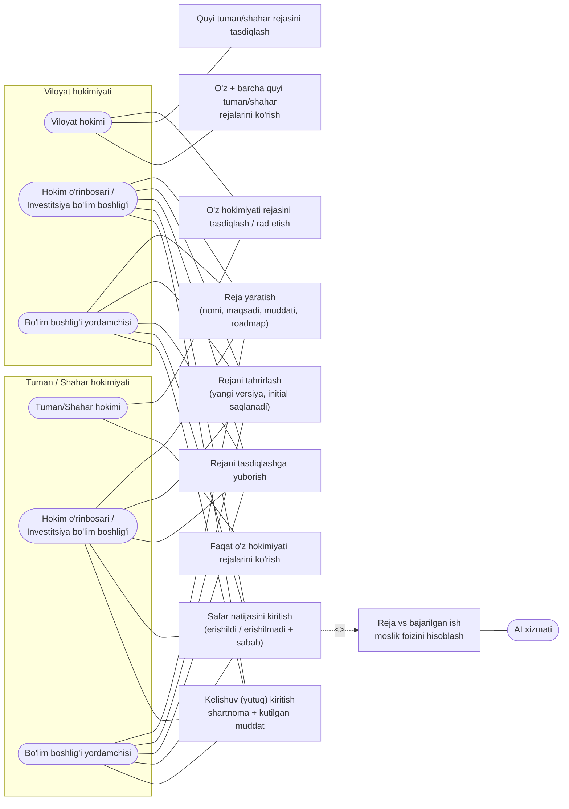
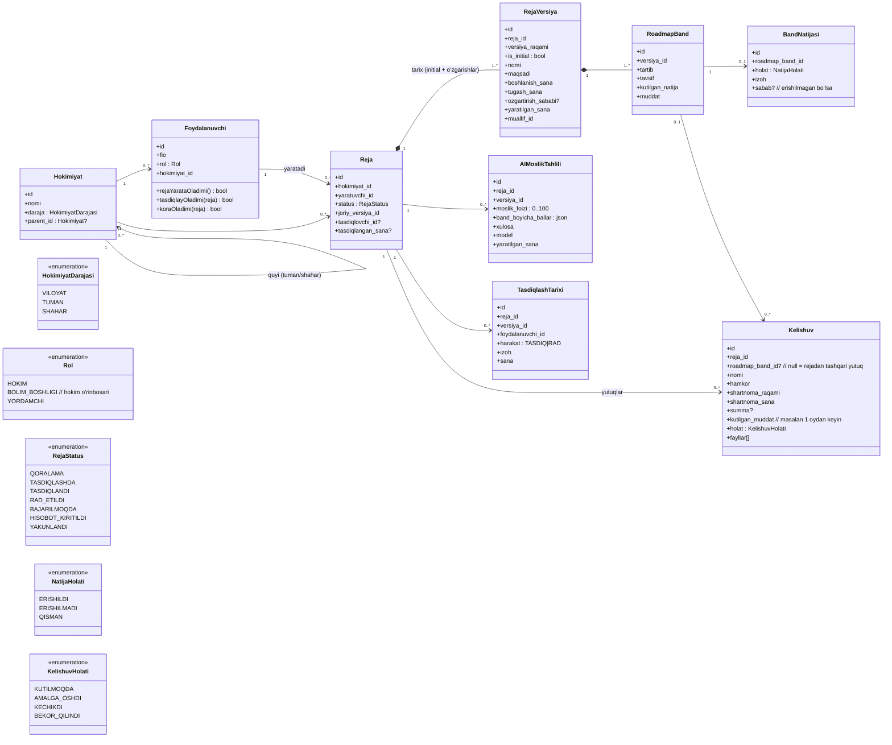
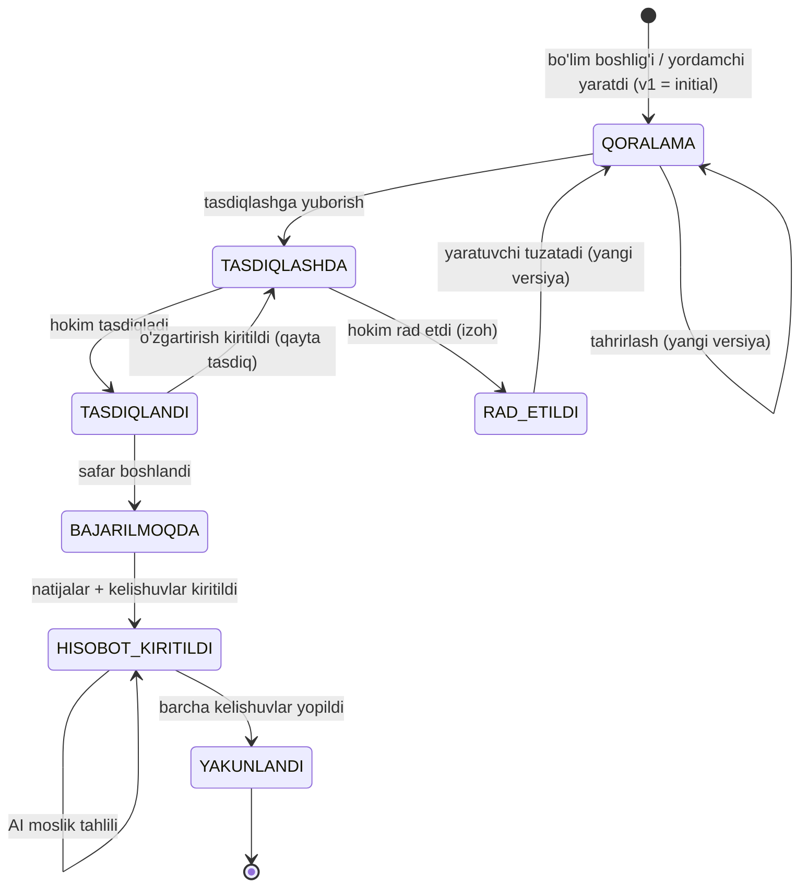
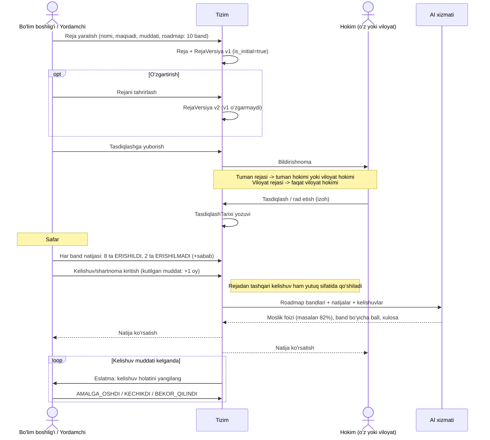
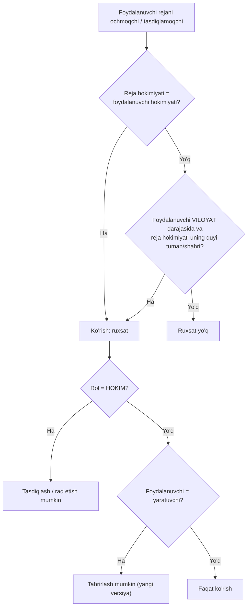

# Investitsiya safarlari tizimi — UML diagrammalar

## 1. Use Case (rollar va huquqlar)

Qoidalar:
- Reja yaratadi: bo'lim boshlig'i (= hokim o'rinbosari) va uning yordamchisi.
- Tasdiqlaydi: hokim. Viloyat hokimi — viloyat + uning barcha tuman/shahar rejalarini. Tuman/shahar hokimi — faqat o'z hokimiyati rejalarini.
- Tuman hokimi viloyat rejasini ko'rmaydi va tasdiqlay olmaydi.
- Rejani faqat yaratuvchi tahrirlaydi; birinchi versiya (initial) o'zgarmas holda saqlanadi.

## 2. Class diagram (ma'lumotlar modeli)

## 3. Reja holatlari (State diagram)

## 4. Asosiy jarayon (Sequence diagram)

## 5. Ko'rish va tasdiqlash huquqi (Activity)

## 6. AI moslik foizi — hisoblash g'oyasi

- Kirish: tasdiqlangan versiyadagi har bir `RoadmapBand` (kutilgan natija) va unga bog'langan `BandNatijasi` + `Kelishuv`.
- AI har band uchun semantik moslik balli beradi (0–100), sababini izohlaydi.
- Umumiy foiz = bandlar ballining o'rtachasi (ixtiyoriy vaznlar bilan).
- Rejadan tashqari kelishuvlar foizga kirmaydi, "qo'shimcha yutuq" sifatida alohida ko'rsatiladi.
- Natija `AIMoslikTahlili` jadvalida tarix bilan saqlanadi.
